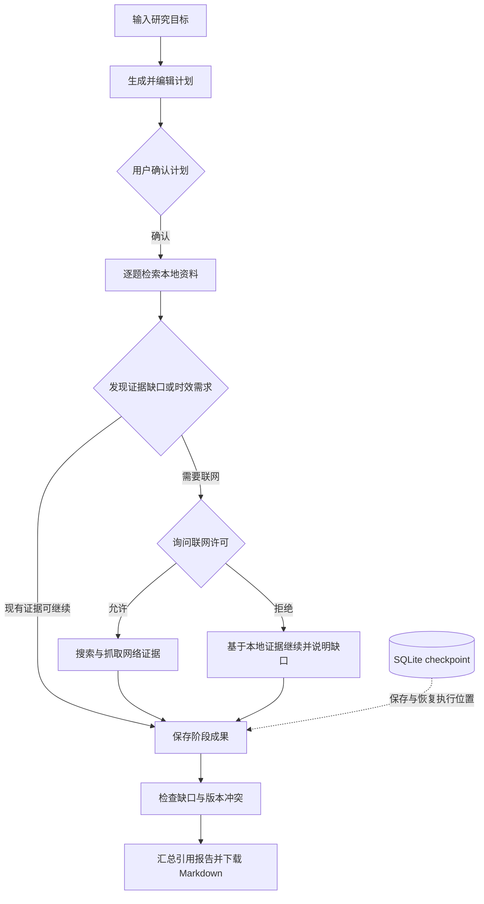
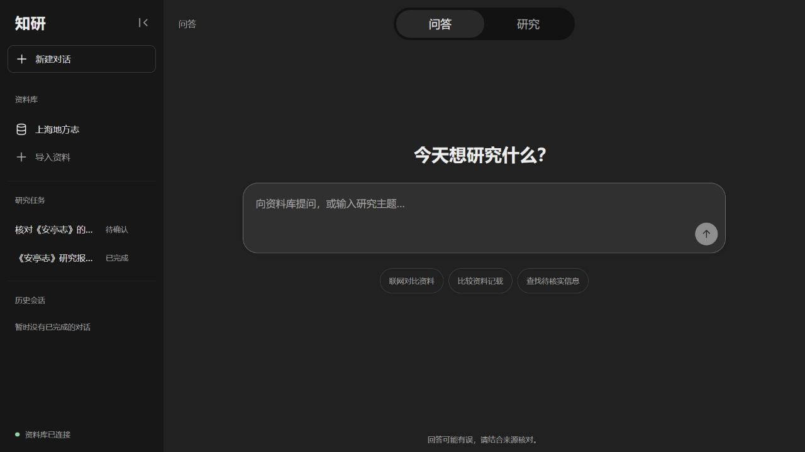
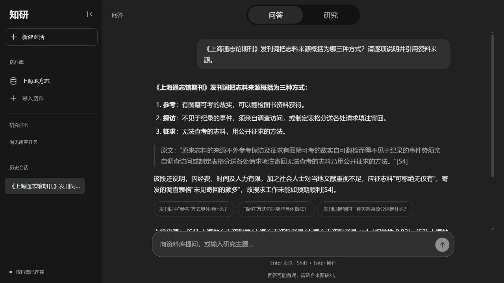
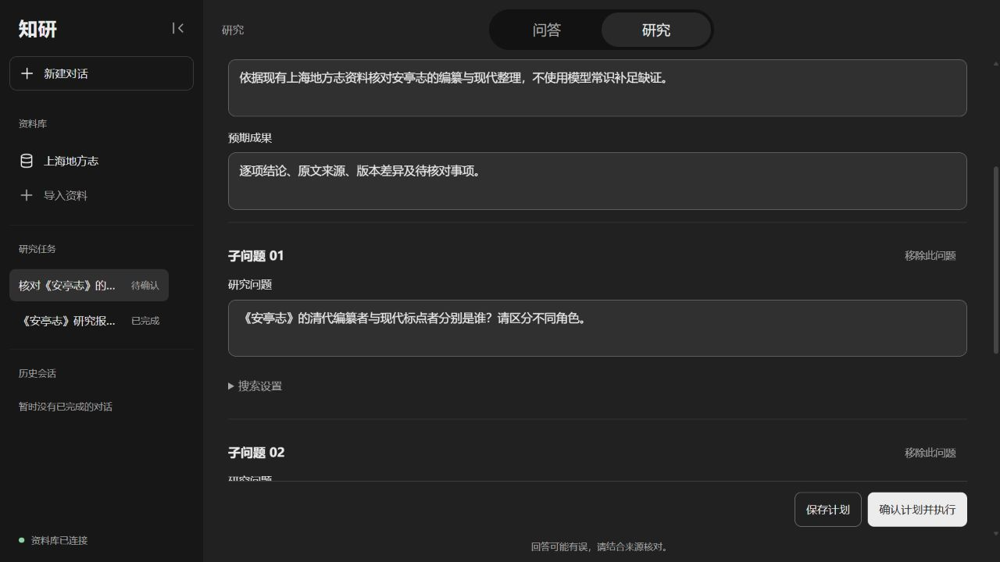
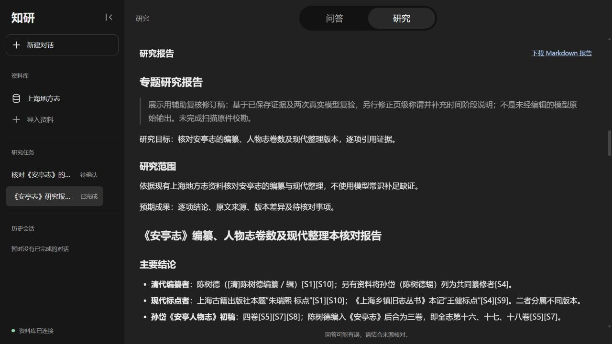

# 知研 · 中文资料问答与专题研究助手

面向中文资料的个人研究助手：从带来源的问答，到可编辑确认的研究计划、分题取证、中断恢复与 Markdown 报告导出。

网页、SQLite 存储与 BGE-M3 / Milvus 检索在本地运行，生成调用 DeepSeek API。

[界面展示](#界面展示) · [技术难点](#三个技术难点) · [快速启动](#快速启动) · [验证与证据](docs/project/evidence.md) · [详细文档](docs/project/README.md)

## 30 秒看懂项目

中文资料研究往往需要反复查找出处、核对不同版本，并在任务失败后重新整理材料。知研把这些步骤组织为可检查、可恢复的工作流：用户先确认研究计划，系统逐题检索和保存证据，再检查缺口与冲突，汇总带引用的报告。普通问答则提供流式回答、来源展示与会话历史。



技术栈：Python 3.12 · LangChain · LangGraph · DeepSeek API · BGE-M3 · Milvus · SQLite · 原生 HTML / CSS / JavaScript。

## 界面展示

以下四张图来自真实网页的独立展示环境。点击图片可查看原图；两列缩略图用于快速浏览，正文细节建议打开原图查看。

<table>
  <tr>
    <th width="50%">问答工作区</th>
    <th width="50%">真实问答结果</th>
  </tr>
  <tr>
    <td width="50%" valign="top">
      <a href="docs/assets/qa-workspace.jpg"></a>
      <p>资料库、历史会话与问答入口集中在同一页面。</p>
    </td>
    <td width="50%" valign="top">
      <a href="docs/assets/qa-answer.jpg"></a>
      <p>实际问答、逐项说明与原文引用。<a href="docs/assets/qa-answer-sources.jpg">查看来源列表</a>。</p>
    </td>
  </tr>
  <tr>
    <th>研究计划编辑</th>
    <th>研究报告</th>
  </tr>
  <tr>
    <td width="50%" valign="top">
      <a href="docs/assets/research-plan.jpg"></a>
      <p>确认执行前可编辑研究范围、预期成果和子问题。</p>
    </td>
    <td width="50%" valign="top">
      <a href="docs/assets/research-report.jpg"></a>
      <p>辅助复核修订稿、来源引用与 Markdown 下载。</p>
    </td>
  </tr>
</table>

问答图来自 2026-11-01 隔离会话的真实生成，回答与本地文本原文核对一致，未编辑回答；单题示例不代表全库准确率或扫描原件校勘通过。研究计划复用已保存示例，报告为辅助复核修订稿，不代表新一轮自动生成或内容验收通过。

## 三个技术难点

| 难点 | 解决方式 | 验证与边界 |
|---|---|---|
| 长流程存在人工确认、失败与恢复，已取得的成果需要复用 | 用单 Agent 的 LangGraph StateGraph 编排研究阶段，interrupt 承接计划确认与联网询问；SQLite checkpoint 保存执行位置及中间成果，后台执行与网页连接解耦 | 已有[跨进程恢复与下载记录](eval/reports/interview_completion_20261101.md)。服务重启后需主动继续；外部调用成功但尚未落盘时仍可能重复调用，不能保证恰好计费一次 |
| 本地资料和网络来源需要统一引用，联网及索引写入需要明确边界 | BGE-M3 / Milvus 提供本地证据；普通问答与专题研究分别管理联网许可；来源使用 `[S#]` / `[W#]` 区分，资料导入需显式触发 | [工作流说明](docs/research-workflow.md)记录授权与调用上限；[最新内容复核](eval/reports/manual_research_review_20261101.md)仍有漏召回与卷数归纳问题，引用标签合法不等于事实受到支持 |
| 检索命中、答案完整与引用支持不能用一个指标替代 | 使用统一 100 题评测，分别检查检索、整题正确、引用支持和拒答；记录延迟、用量、原始结果与 AI 辅助审核 | [第四周对照](eval/reports/week4_completion_20261031.md)中降本候选伴随 P95 和质量退化，未默认启用；题集参与过开发，AI 审核不能替代独立专家复核 |

## 当前状态

**工程流程可展示，自动研究内容完整性未通过。** 最新[网页手测复核](eval/reports/manual_research_review_20261101.md)仍发现整理本漏召回及人物／全志卷数归纳问题；原始失败与辅助修订稿分别保留。检索和本地追问候选保持关闭，不将实验改善写成默认业务效果。

运行记录、测试快照及检查范围见[验证与证据](docs/project/evidence.md)和[收尾记录](docs/project-closeout-2026-11-01.md)；历史成绩以各自注明日期、模型和题集的报告为准。尚未完成全量扫描原件校勘，不承诺自动研究稳定正确或生产并发能力。

## 快速启动

环境：Windows 11、Python 3.12（64 位）、uv、Docker Desktop（WSL 2 后端）、DeepSeek API 密钥，以及本地 BGE-M3 模型。首次安装和下载模型需要联网，生成和搜索可能产生费用。

```powershell
uv sync
Copy-Item .env.example .env
```

首次配置时将 API 密钥填入本机 `.env`；已有 `.env` 时跳过复制，保留现有配置。默认生成模型为 `deepseek-flash`，模型和端口配置见[完整部署说明](docs/local-setup.md#安装依赖)。

```powershell
docker compose up -d
uv run python -m research_agent.cli web
```

打开 <http://127.0.0.1:8765>。已有索引无需再次导入；新环境须先准备资料，并按[导入说明](docs/local-setup.md#导入资料并建立索引)建立索引。**`ingest` 会重建当前基础集合，执行前须确认资料目录包含全部要保留的文件。**

## 详细文档

| 阅读目的 | 入口 |
|---|---|
| 了解功能、架构与技术取舍 | [项目说明与常见问题](docs/project-guide.md) |
| 查看完整研究、授权与恢复演示 | [5—8 分钟演示](docs/demo.md) |
| 安装、配置、导入资料与运行维护 | [本地部署与使用说明](docs/local-setup.md) |
| 核对测试、质量评测与真实结果 | [证据索引](docs/project/evidence.md) · [评测复现方法](eval/README.md) |
| 了解失败、未采用优化与后续工作 | [已知限制](docs/project/limitations.md) |

完整导航见[四部分项目文档](docs/project/README.md)。
