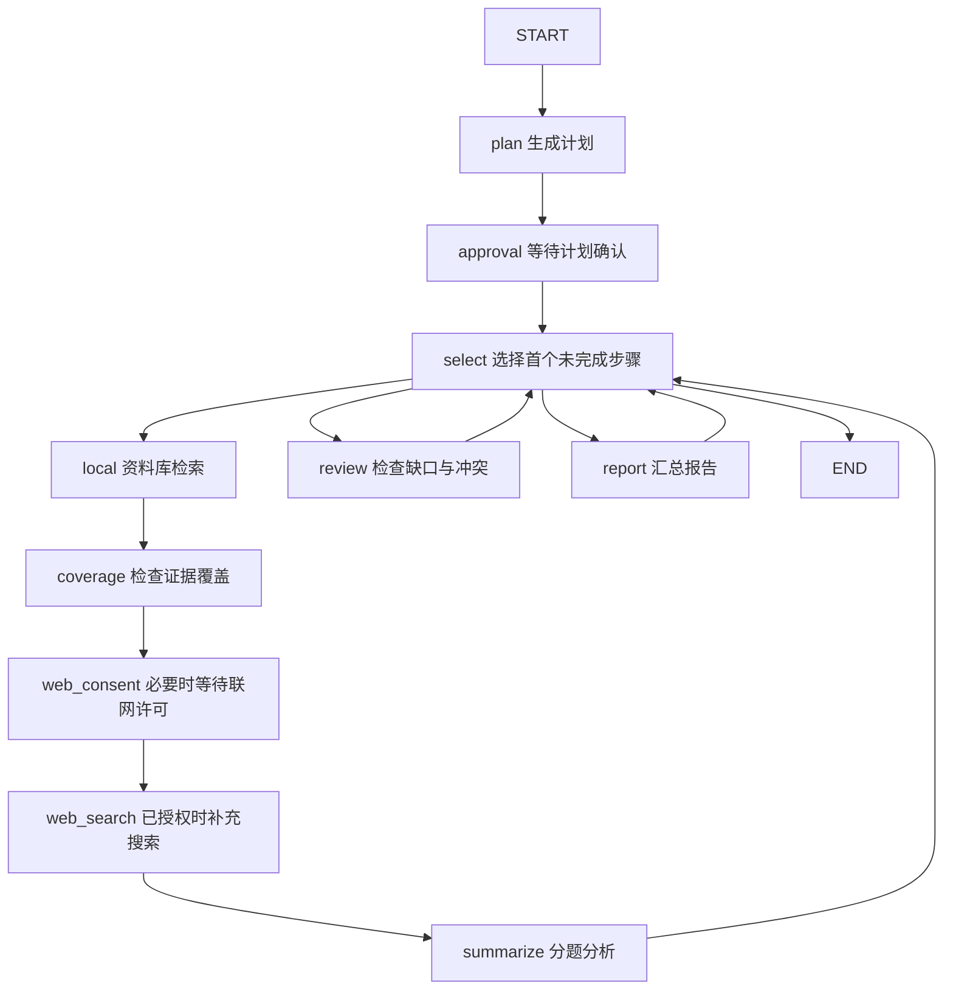

# 跟着本项目学习 LangGraph

这次迁移把研究任务的执行顺序与恢复位置交给 LangGraph，复用原有模型、检索、搜索、授权接口和报告格式。普通问答仍保留原代理循环。以下先做一个无 API 练习，再读真实项目。

## 1. 用十分钟亲手体验暂停与恢复

依赖已在 `pyproject.toml` 和 `uv.lock` 中锁定；新环境先执行 `uv sync --locked`。在项目目录分别运行：

```powershell
# 第一条命令生成固定的示例计划，然后暂停并结束本次进程。
.\.venv\Scripts\python.exe examples/learn_langgraph.py start --thread lesson1

# 第二个进程仍能读到刚才的 State 和 next，不需要调用模型。
.\.venv\Scripts\python.exe examples/learn_langgraph.py inspect --thread lesson1

# 人工同意，使用相同 thread_id 恢复；将 approve 换成 reject 可练习拒绝分支。
.\.venv\Scripts\python.exe examples/learn_langgraph.py approve --thread lesson1

# 查看练习图的 Mermaid 文本。
.\.venv\Scripts\python.exe examples/learn_langgraph.py diagram
```

第一次应看到 `next: ["approve"]`，`interrupts` 中有计划；批准后 `next` 与 `interrupts` 都为空，`result` 有完成结果。要重新练习，换成 `--thread lesson2`；脚本不会覆盖已有练习。

这些命令不调用模型、Milvus 或搜索服务；仅写入 `work/langgraph-learning/lesson.sqlite`，与真实研究任务隔离。批准和拒绝的两个分支都有跨进程自动测试。

## 2. State、Node、Edge 各是什么

| 概念 | 含义 | 练习代码 | 项目中的对应 |
| --- | --- | --- | --- |
| State | 节点共享的数据快照 | `LessonState` | `research_graph.py` 的 `ResearchState` |
| Node | 接收 State、完成一个动作并返回更新的函数 | `plan`、`approve`、`finish` | `workflow.py` 的 `_graph_step` 分派到具体业务动作 |
| Edge | 决定节点之间的执行路径 | `add_edge`、`add_conditional_edges` | `select` 按未完成步骤选择取证、检查或报告 |
| compile | 把图定义变成可执行对象 | `builder.compile(...)` | `build_research_graph(...)` 的返回值 |
| checkpointer | 保存图状态和执行位置 | `SqliteSaver` | 任务目录中的 `checkpoints.sqlite` |
| thread_id | 一次图执行历史的身份 | `lesson1` | 研究任务的 `id` |

Node 不一定调用模型。练习中的 `plan()` 只返回固定列表，真实项目中的 `local` 节点执行本地检索，`select` 节点只是普通条件判断。条件边也可以由程序确定，无需每条边都调用模型。

`TypedDict` 描述 State 的字段形状，便于阅读和类型检查；它本身不会在运行时校验模型输出。因此项目仍保留 `validate_plan()` 和联网许可校验。

节点通过返回值更新 State，例如：

```python
def plan(state):
    return {"outline": ["应用场景", "实施条件", "局限"]}
```

它只更新 `outline`，其他字段保留。默认更新规则（reducer）是替换同名字段，不是自动拼接列表。本项目的 `task` 是嵌套字典，节点先 `deepcopy` 再返回完整的新 `task`；取证串行执行，暂不需要并行列表合并 reducer。

## 3. 把真实研究流程读成一张图

先读 `src/research_agent/research_graph.py`，再读 `workflow.py` 中的同名业务动作：



这是正常业务路径；代码还为节点增加了取消后的结束边。历史任务可从已有进度直接进入 `select`，已有计划但未确认的任务可直接进入 `approval`。

`select` 的回边用于推进有限的 3–5 个子问题及两个汇总步骤，不是无限自主研究，也没有新增自动补搜循环。图配置 `recursion_limit=128` 为这些节点流转留出上限；它限制图执行步数，不是模型 token 数或外部工具调用次数。

## 4. interrupt 为什么不是 input

`input()` 要求进程一直等待终端输入。`interrupt()` 将待确认内容交回调用者，由 checkpointer 保存位置，当前执行可以结束；用户稍后通过网页或另一个进程回答。

```python
decision = interrupt({"question": "是否允许联网？"})
# 暂停时不会运行下面的代码；恢复后 decision 得到用户提交的值。
return {"approved": decision}
```

调用方使用相同身份恢复：

```python
config = {"configurable": {"thread_id": task_id}}
graph.invoke(Command(resume=True), config)
```

真实项目的恢复值是对象：计划确认传入经过接口校验的任务快照，联网回答传入 `{"allow_web": True}` 或 `False`。网页不需要知道 LangGraph 的内部协议，原来的确认和 `web-consent` HTTP 接口负责转换。

**恢复时，中断所在节点会从头运行，不是从 Python 某一行无条件接着执行。** 因而本项目把模型生成放在 `plan`，确认放在 `approval`；检索放在 `local`，等待许可放在 `web_consent`，真正搜索放在后面的 `web_search`。重放许可节点不应重新发起检索或搜索。

框架通过 `GraphInterrupt` 交还控制权。它虽然继承 `Exception`，但不应被通用异常处理转换成“任务失败”；`_graph_step` 明确将它重新抛给 LangGraph。

## 5. checkpoint、JSON 和恢复的区别

`workflow.py` 的 `_run()` 使用任务 ID 作为 `thread_id`，并以 `durability="sync"` 执行：当前节点的 checkpoint 落盘后，再执行下一节点。用内存 saver 无法跨进程重启恢复，因此这里使用本地 SQLite。

| 数据 | 负责什么 |
| --- | --- |
| SQLite checkpoint | LangGraph 的 State、待执行节点、人工暂停和执行历史，是图恢复位置的依据 |
| 原任务 JSON | 网页读取的任务视图、阶段成果及人工决定，也用于兼容迁移前的任务 |
| ConversationStore SQLite | 普通问答完整历史，模型近期上下文单独读取，与研究图分开 |

失败重试用 `graph.stream(None, config, ...)` 继续待执行节点；回答人工暂停用 `Command(resume=...)`。不能用新 `thread_id` 冒充恢复，因为那会开启另一份执行历史。

迁移前没有 SQLite checkpoint 的 JSON 任务，在用户确认、继续或重试时才初始化图，并跳过已有的成功步骤和取证结果。已完成历史任务仍可直接查看，不重建 Milvus 索引，不改写历史引用标签。

SQLite 和 JSON 不是跨存储事务。节点会先更新网页视图，再由框架保存 checkpoint；崩溃窗口内，外部请求仍可能重做。不能把 checkpoint 等同于外部付费请求恰好执行一次。终态 checkpoint 已保存但 JSON 滞后时，服务以图终态修复视图；中断重放时也保护已经落盘的人工决定，不让旧等待快照覆盖它。

## 6. 用测试检验自己是否理解

阅读 `tests/integration/test_langgraph_migration.py`，尝试解释这些断言：

- 生成计划后 `snapshot.next == ("approval",)`：图记住了下一节点，而非只记录“待确认”文案。
- 等待联网时 `snapshot.next == ("web_consent",)`，没有发生搜索：许可是实际执行边界。
- 阶段分析失败后 `next == ("summarize",)`：重试不会重跑成功的检索节点。
- 同一个 SQLite 文件中的两个任务使用不同 `thread_id`，一个完成不影响另一个等待。
- 构建新的服务实例后仍能回答中断：状态来自 SQLite，不依赖原来的 Python 内存对象。

可以先预测练习中 `reject` 的 `result`，再运行验证；然后在 `research_graph.py` 找到选取下一题的条件边，说明它何时走向 `review`。这些都能说清，再学习并行、reducer、子图会更容易。

官方参考：[Graph API](https://docs.langchain.com/oss/python/langgraph/graph-api)、[持久化](https://docs.langchain.com/oss/python/langgraph/persistence)、[Interrupts](https://docs.langchain.com/oss/python/langgraph/interrupts)。本次锁定 LangGraph 1.2.18、SQLite checkpoint 3.1.2；阅读其他版本示例时需核对接口。
