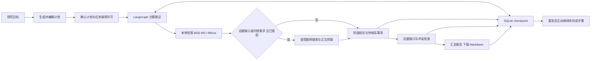

# 项目介绍与架构

当前功能、技术取舍和验证边界见[项目说明](project-guide.md)，操作步骤见[精简演示脚本](demo.md)。下文涉及2026-10-19/20的模型及性能数字仅作为有对应日期的历史记录，不代表当前Flash业务成绩。

## 项目名称

知研专题研究工作流助手：计划确认、分题取证、证据检查、可恢复执行与报告汇总。

## 展示入口

运行本地网页，输入专题研究目标，编辑并确认 3–5 个子问题后自动执行，查看取证快照、阶段成果、缺口与来源分歧，下载 Markdown 报告。任务独立保存步骤检查点，刷新页面不会中断执行，服务重启后可主动继续。RAG 与网络搜索作为取证工具，研究任务的联网许可单独确认。顶部可切换原有普通问答。

技术组件为 Python、LangChain、LangGraph、BGE-M3、Milvus 和 DeepSeek；研究编排使用 StateGraph、SQLite checkpoint 和 interrupt，JSON 保留为网页任务视图。接口和可复现模拟演示见 [研究工作流说明](research-workflow.md)。

## 当前模型说明

2026-10-31 当前默认模型改为 `deepseek-flash`，见[模型配置规范](model-spec.md)。2026-10-20 使用 DeepSeek-V4-Pro 重跑的历史回归中，检索结果保持一致；12道可回答题中10道核心答案一致、1道部分、1道合理拒答；4道合成无答案题拒答。下文记录的检索优化属于2026-10-19历史工作，V4-Pro历史性能与完整局限见 [V4-Pro报告](acceptance-2026-10-20.md)，不能作为 Flash 的实测成绩。

## 功能说明

当前功能概览统一维护在[项目说明](project-guide.md#功能概览)，避免多处更新不一致。

下列检索和性能数据属于历史 RAG 工作，需与新增工作流能力分开介绍：

- 开发中文资料RAG问答应用，结合本地BGE-M3与Milvus管理28,216个文本块，提供流式回答、来源引用、多轮会话和基于SHA-256的独立集合增量导入。
- 建立固定检索评估与证据审核流程，通过扩大候选、过滤低信息标题及去重，将20题开发集Hit@4由60%提升至70%；另用20道未参与调优的问题验收，Hit@4为80%。
- 在RTX 5070 Ti Laptop GPU环境下完成单用户实测：2026-10-20的V4-Pro回归中60次预热后检索中位数49 ms、P95 61 ms；16次证据问答请求全部成功，检索加回答中位数1.74 s；4道合成无答案题均拒答。

上述性能数据用于说明对应历史环境下的运行结果。检索改进数据为2026-10-19历史小样本，性能数据为2026-10-20所用模型的本地小样本；不写成全库准确率、并发性能或生产SLA。

## 使用演示顺序

主线改为一次完整研究任务，详细操作见 [演示脚本](research-workflow.md#演示脚本)。先展示可编辑计划与联网许可，再展示取证、阶段成果、证据检查和报告；随后演示刷新或重启后的恢复。可以使用无外部服务的模拟入口，但必须明确标注证据为模拟数据。

以下保留为普通问答和历史检索评估的补充演示：

1. 打开网页，问“《安亭志》的清代编纂者和现代标点者分别是谁？”，查看本轮来源；资料中的不同版本著录应分别说明。
2. 追问“刚才回答的现代标点者叫什么名字？”，展示会话历史与带上下文的本轮检索。
3. 提出一个库内不存在的实体问题，展示有召回候选也不必编造答案；说明阈值尚不能解决全部无答案判断。
4. 打开验收报告，说明开发集与独立集的区别，展示失败题、原始候选和性能口径。

## 架构

## 技术取舍

- 本地向量计算减少外部嵌入依赖，DeepSeek负责生成；更换向量模型需要重建索引。
- 原始和新增集合隔离，避免追加资料时重建基础库；按SHA-256跳过重复文件。
- 保留失败记录，区分文件命中和段落支持；标签合法性检查不等同于引用语义正确。
- 研究任务使用 LangGraph，普通问答保留原代理循环；采用单进程执行器及 SQLite checkpoint，不宣称多进程协调或外部请求恰好执行一次。

运行命令、原始数据与局限见 `docs/acceptance-2026-10-19.md` 和 `eval/README.md`。

LangGraph 迁移的概念、代码阅读顺序与无 API 练习见 [学习指南](langgraph-learning.md)。迁移不等于改善事实正确率，原有真实研究验收的内容问题仍需独立验证。
