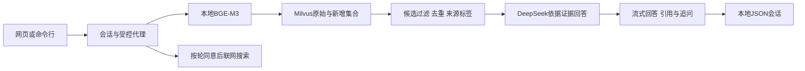

# 项目介绍与简历素材

## 项目名称

中文地方志资料研究助手：本地检索、流式问答与可追溯引用。

## 展示入口

运行本地网页，提出资料问题，查看流式回答和来源；可继续追问并恢复本地会话。新增文件先暂存，明确导入后追加到独立集合；联网搜索须按轮同意。技术组件为Python、LangChain、BGE-M3、Milvus和DeepSeek，代理由普通Python循环协调。

## 当前模型说明

2026-10-20已切换DeepSeek-V4-Pro并重跑回归。检索结果保持一致；12道可回答题中10道核心答案一致、1道部分、1道合理拒答；4道合成无答案题拒答。以下简历素材中的检索优化属于2026-10-19历史工作，当前模型性能与完整局限见 [V4-Pro报告](acceptance-2026-10-20.md)。

## 简历表述

- 开发中文资料RAG问答应用，结合本地BGE-M3与Milvus管理28,216个文本块，提供流式回答、来源引用、多轮会话和基于SHA-256的独立集合增量导入。
- 建立固定检索评估与证据审核流程，通过扩大候选、过滤低信息标题及去重，将20题开发集Hit@4由60%提升至70%；另用20道未参与调优的问题验收，Hit@4为80%。
- 在RTX 5070 Ti Laptop GPU环境下完成单用户实测：当前V4-Pro回归中60次预热后检索中位数49 ms、P95 61 ms；16次证据问答请求全部成功，检索加回答中位数1.74 s；4道合成无答案题均拒答。

篇幅有限时保留前两条，性能数据用于面试补充。检索改进数据为2026-10-19历史小样本，性能数据为2026-10-20当前模型本地小样本；不写成全库准确率、并发性能或生产SLA。

## 面试演示顺序

1. 打开网页，问“《安亭志》的清代编纂者和现代标点者分别是谁？”，查看本轮来源；资料中的不同版本著录应分别说明。
2. 追问“刚才回答的现代标点者叫什么名字？”，展示会话历史与带上下文的本轮检索。
3. 提出一个库内不存在的实体问题，展示有召回候选也不必编造答案；说明阈值尚不能解决全部无答案判断。
4. 打开验收报告，说明开发集与独立集的区别，展示失败题、原始候选和性能口径。

## 架构

## 技术取舍

- 本地向量计算减少外部嵌入依赖，DeepSeek负责生成；更换向量模型需要重建索引。
- 原始和新增集合隔离，避免追加资料时重建基础库；按SHA-256跳过重复文件。
- 保留失败记录，区分文件命中和段落支持；标签合法性检查不等同于引用语义正确。
- 当前用简单代理循环和进程内锁；没有引入LangGraph，也未宣称多进程写入协调。

运行命令、原始数据与局限见 `docs/acceptance-2026-10-19.md` 和 `eval/README.md`。
